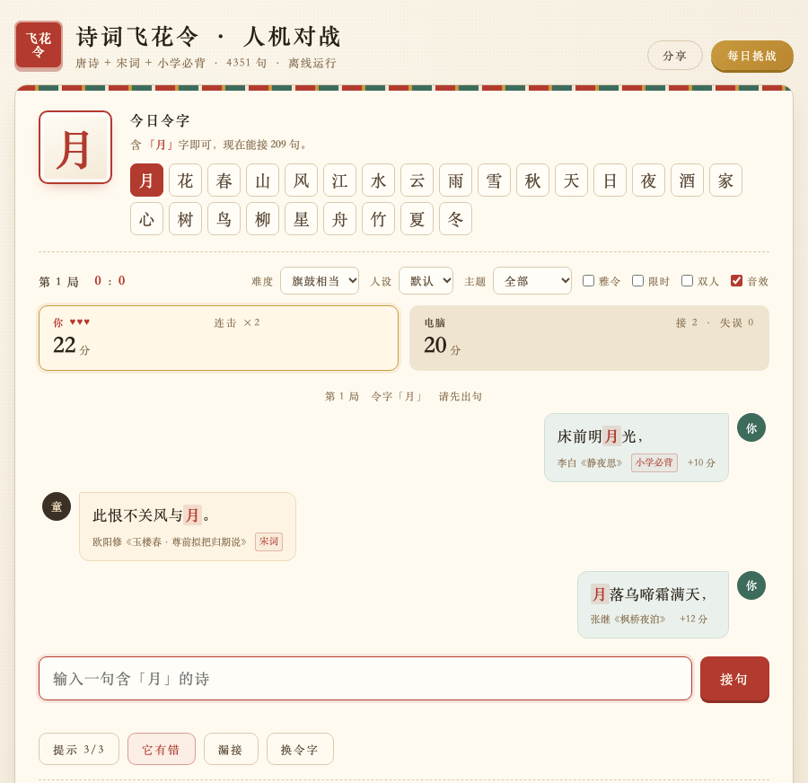
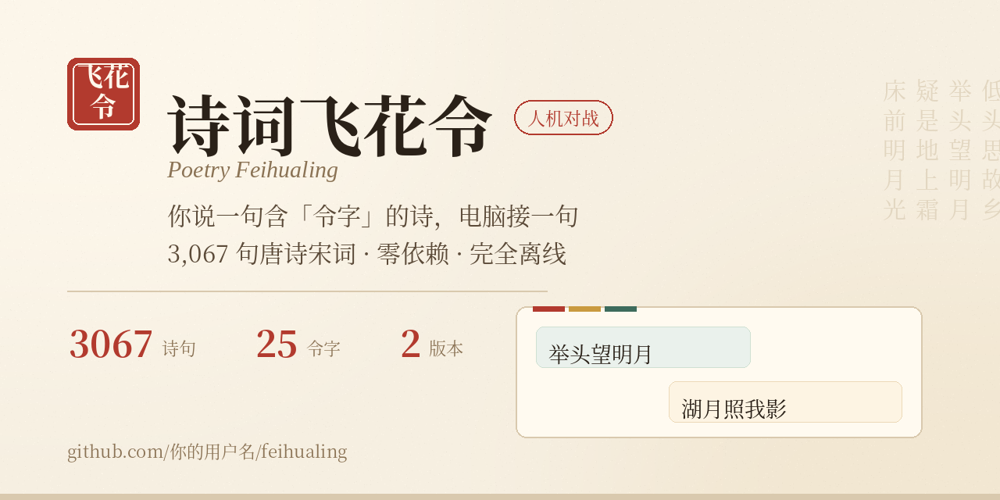
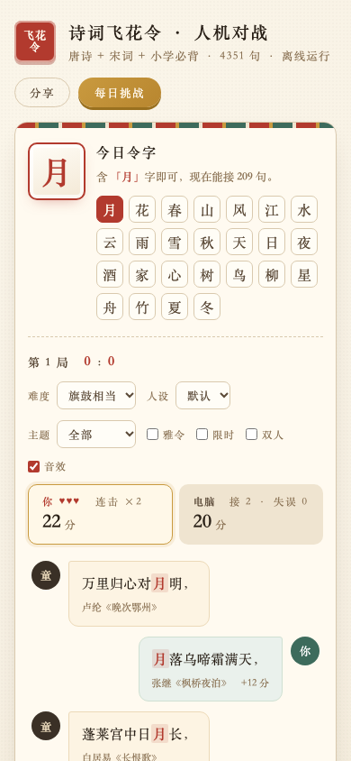

# 诗词飞花令 · Poetry Feihualing

> 和电脑玩飞花令 —— 你说一句含令字的诗，电脑接一句。
> A Chinese poetry word-chain game: you quote a verse containing the key character, the AI answers back.



> Social Preview：

**在线试玩 / Play online**: <https://tjnh05.github.io/feihualing/>　·　手机扫码 ↓


## 这是什么

飞花令是中国古代的酒令游戏：参与者轮流说出含有指定字的诗句，接不上者输。这个项目让电脑当对手——它从 4414 句诗词里检索、应答、计分，永远不累。

| 特点 | 说明 |
|---|---|
| **4414 句诗词 / 578 篇** | 从《诗经》一路接到清代：唐诗 3171、宋词 877（含宋诗与五代词）、小学必背 165，另有诗经、汉乐府、古文、元明清、禅诗等 201 句；宋词与唐诗名篇基本按整首收录 |
| **25 个令字** | 月花春山风雨雪……含"夏""冬"等冷门令字 |
| **三档难度** | 初出茅庐 / 旗鼓相当 / 出口成章，电脑的卡壳与说错概率不同 |
| **雅令 / 限时** | 可选正宗玩法：令字逐轮往后挪、同一诗人不重复、限时每回合 40/30/20 秒按难度分 |
| **主题限令** | 限定在唐诗 / 宋词 / 小学必背里接句，接不下去会自动退回全部 |
| **电脑人设** | 李白只吟唐诗、易安只说宋词、蒙童专背小学课本，还带一句开场白 |
| **双人同机** | 甲乙轮流接句，各自 3 条命 3 次提示，一局定胜负 |
| **每日挑战** | 同一天两台机器抽到同一道题，战绩存本地只留最好一次 |
| **本机战绩** | 胜 / 负 / 和、当前与最长连胜、累计接句、4414 句里接过多少句、打卡与连续打卡天数，只写在这台浏览器，可一键清空 |
| **带走这一局** | 收局一颗按钮，把这一局的事实（比分、字位、连击、双方各接了哪几句）加写作题目（赏析与改写）拼成一段纯文本复制走，粘到别的软件里再加工 |
| **分享** | 标题栏「分享」一张卡片给全：二维码、可复制的链接、手机上的系统分享面板 |
| **音效动效** | 答对、漏接、抓错、收局各有声音，分数与令字会动一下，可一键关掉 |
| **两个版本** | 网页版（纯静态单文件）是唯一维护的版本；Python 桌面版已归档 |
| **零依赖** | 网页版双击即玩；归档的 Python 版只需标准库 |
| **完全离线** | 所有数据内置，不需要联网 |



## 快速开始

### 网页版（最简单）

直接用浏览器打开 [`index.html`](index.html) 即可，或者部署到 GitHub Pages 在线玩。

### Python 桌面版（已归档）

> 桌面版停止更新，代码只作存档。玩法口径停在归档那天 —— 之后的分享卡片、接对落印、收局钤印都只在网页版里有。下面这段保留原样，供还想跑一下的人参考。

```bash
cd python
python3 feihualing.py
```

需要 Python 3（自带 tkinter），无需安装任何第三方库。

### 自己添加诗句（归档版提供）

桌面版底部有「添加诗句」按钮，弹窗里填诗句（一句一行，也可以整首贴进来，会按 `。！？；` 自动拆句）、作者、出处和类别，确认后：

- 立刻并入内存诗库，**当前这一局就能接**，也会被电脑抽到
- 写进 `python/data/user_poems.json`，下次启动自动加载，重跑 `build_poems.py` 也不会被覆盖
- 自动查重（忽略标点），并限制每句 2–26 字；作者/出处留空则记作「佚名《自编》」

网页版是单文件、数据内嵌，没有运行时的写入口。要给它加句子，走同一条数据链路：改 `python/tools/` 里的源，跑 `build_poems.py` 重新生成，再把结果同步进 `index.html`。

### 重建数据（可选）

```bash
cd python/tools
python3 build_poems.py
```

会重新执行"清洗 → 拆分 → 合并 → 去重"全流程，并打印质量报告（句数、体裁分布、令字覆盖）。

## 数据说明

| 类别 | 句数 | 界面主题下拉 | 来源 |
|---|---|---|---|
| 唐诗 | 3,171 | 可选「唐诗」 | [chinese-poetry](https://github.com/chinese-poetry/chinese-poetry)《唐诗三百首》（MIT）的五七言绝句 / 律诗 / 古诗与乐府 2,609 句，加上手工整理的三百首之外名篇 562 句（长恨歌、琵琶行、春江花月夜、茅屋为秋风所破歌、卖炭翁、将进酒等） |
| 宋词 | 877 | 可选「宋词」 | 词 678（苏轼、李清照、辛弃疾、柳永、欧阳修、晏殊、晏几道、秦观、周邦彦、姜夔、岳飞等）＋ 宋诗 158（王安石、苏轼、陆游、杨万里、朱熹、范成大、文天祥等）＋ 五代词 41（李煜《虞美人》《相见欢》《浪淘沙令》《破阵子》），三档在代码里归并成一档 |
| 小学必背 | 165 | 可选「小学必背」 | 部编版（统编版）语文教材 1–6 年级；其中《墨梅》《石灰吟》《竹石》《己亥杂诗》《村居》这 20 句本就是元明清作品 |
| 不归任何主题 | 201 | 只有「全部」接得到 | 古文 56（《滕王阁序》《岳阳楼记》《醉翁亭记》）、诗经 28、建安 18、禅诗 18（唐宋偈颂：《无门关》「春有百花秋有月」、惠能与神秀《菩提偈》、黄檗「怎得梅花扑鼻香」、船子德诚「满船空载月明归」、寒山「吾心似秋月」、李翱「云在青天水在瓶」等）、元明清诗 34、汉乐府 15、魏晋 14、元明清词 15、谚语 3；元明清那 49 句与禅诗那 14 句都是手工整理，只收含令字的半联（「本来无一物，何处惹尘埃」这样更有名的句子因为不含令字反而没收），版本分歧处取大陆通行本 |
| **合计** | **4,414** | | |

数据处理过程中的三个关键步骤（详见 `python/tools/build_poems.py`）：

1. **繁转简**：原数据为繁体，不转换则搜"风"查不到"風"
2. **去校勘注**：删除"(明年一作：年年)"等 77 处注解，连底本里被切断的半截括号（如 `(猿`）一起清掉
3. **长句拆分**：将塞了整段诗的记录按标点切成单句

## 玩法规则

下面这些规则在网页版里也有一份精简版，就在页面底部那条「玩法说明 · 数据来源」里 —— 点一下标题能收起，收起状态会记住，下回打开还是收着的。

**基础规则**

- 每局选一个"令字"（25 个可选），双方轮流说出**含有令字**的诗句
- 答对得 10 分，连击每次额外 +2 分；接错或要提示都会把连击清零
- 诗句必须在诗库中能找到：写整句、只写半句、甚至把整联整首贴进来都认，同一句不能重复使用
- 诗库见底时本局结束，比总分定胜负
- （已归档的）桌面版可随时「添加诗句」，新句子立即参与当前这局；网页版没有这个入口

**赛制与生命值**

- 三局两胜，顶部显示"第几局 · 你的胜局 : 电脑的胜局"，后面还跟着和局数与本机生涯战绩（窄屏只留比分，那些小字收掉）
- 每局 3 条命（计分区显示 ♥♥♥），接不上就点「漏接」扣 1 条，3 次漏接本局判负
- 本局结束比总分：**分数高于电脑才算胜，一样多是和局**；命丢光或中途「换令字」直接判负
- 三局打完谁都没到 2 胜（和局占着局数就会这样），比这三局的累计总分；连总分都一样，整场判和
- 电脑说错不影响它得分，但你会少一次抓错加分的机会

**本机战绩**

- 页面上「本机战绩」那栏记的是这台浏览器里的：胜 / 负 / 和、当前与最长连胜、累计接上多少句、在诗库里接过多少**不同**的句子（4414 句的进度条）、打卡天数与连续打卡天数
- 口径是干净的：**胜负与连胜只算人机对战**——每日挑战没有对手（它另算当天最佳），双人同机是两个真人、没有"我"这一方；但接过的句子和打卡天数照单计入，那是在跟这份库较劲，跟用哪种玩法无关
- 全写在本机 localStorage 的 `feihualing.career`，换设备、清缓存、开无痕都会归零，面板里那句"它是个纪念，不是账号"就是这个意思；旁边有「清空本机战绩」，撤不回来所以按一次 confirm

**带走这一局**

收局横幅下面那颗按钮不是新玩法，是个出口：点一下就把这一局拼成一段纯文本复制进剪贴板，粘到别的软件里再加工。

- 文本四段：抬头（第几局或每日挑战、令字、主题）→ 局面事实（双方分数、本局判词、整场比分与实际局数、最长连击、抓到几次错、开了哪些规则）→ 句子清单（你和电脑各接了哪几句，逐句标出令字排在第几字，页面上带题材标签的句子在这里也带同样的标签；抓到过的那句只标「这句是它混进来的」，不说它错在哪，那是留给你的活儿）→ 写作题目
- 题目只有**赏析**与**改写**两类，且都由这一局的规则现生成：开了雅令就要求"把令字依次排在第 1、2、3…… 字位"，限了主题就在主题里另写，禁了诗人就把用过的诗人列出来避开；接上的句子不足三句，改写题整条不出现，一句都没接上则只留一句热身提示，都不留「暂无」那种占位
- 末尾带一句本机口径：这台浏览器累计接过多少个**不同**句子、涉及多少位诗人、其中含本局令字的有几句，请避开已经写过的
- 双人同机那一局没有这颗按钮——两个真人之间没有"我"这一方，这段文本写不出主语
- 全程在本机拼字符串：不联网、不调任何外部服务，也不替你写一个字。它给的是题目和素材，成品得拿到别的软件里去写

**电脑难度（切换立即生效）**

| 难度 | 卡壳率 | 说错率 | 思考延迟 | 限时每回合 |
|---|---|---|---|---|
| 初出茅庐 | 26% | 20% | 0.9 秒 | 40 秒 |
| 旗鼓相当 | 12% | 12% | 0.7 秒 | 30 秒 |
| 出口成章 | 4% | 5% | 0.45 秒 | 20 秒 |

"卡壳"是电脑想不出来，把回合让给你；"说错"是它故意重复旧句、或者抛出一句不含令字的诗，等你抓。两版都在右侧规则栏里直接切换（难度在网页版是规则栏第一个下拉）。打字慢就选低难度——它本来就笨一点，等于拿难度换时间。

**提示与质疑**

- 每局 3 次提示，每次亮出一句的前三个字并 **-5 分**，同时断连击
- 电脑说完一句后，「它有错」按钮才可点：抓到漏字或重复 **+15 分**并续上连击；冤枉它要 **-5 分**且断连击。每句只能质疑一次
- 代价原来是 -10 分，按电脑 12% 的使坏率算，闭眼乱点一下的期望是 -6.6 分，多数人索性一次都不按，「它有错」成了摆设。降到 -5 之后期望约 -3.6 分：乱抓仍然稳亏（博弈还在），看得出问题的人下手有保障，新手也敢试
- 电脑还在思考时，点「漏接」不会扣命，避免误触

**输入即时提示**

输入框下面有一行小字跟着打字变，不用按回车才知道对错：

- 没打到 5 个字：灰字「再打几个字就能认出来了」
- 认出来了：绿字「认得这一句」
- 够 5 个字还认不出来：红字「诗库里没有这一句，看看有没有打错字」
- 认出来了但规则不过：直接说原因（用过了 / 字位不对 / 诗人的句子接过了）

它只回答"认不认"，不吐答案也不进分数，最后还是你自己按回车结算。网页版输入框另外关掉了自动大写、自动纠错和拼写检查，手机上回车键直接显示"发送"。

**雅令与限时（可选玩法，默认关闭）**

这些开关都在右侧规则栏里（和难度、人设、主题排在一起，桌面版在令字区右侧、网页版在计分区上方），勾上后从下一局开始生效。

**雅令**——按传统雅令的规矩打：

- **字位递进**：首轮令字随便排第几；第 2 轮起，令字要排在第 2 字或更后；第 3 轮起要排在第 3 字或更后（最多到第 3 字）。比如令字「月」第 2 轮「明月松间照」可以，「月上柳梢头」不行
- **同一诗人只接一句**：李白接过一次就不能再搬李白。因为同一首诗只有一位作者，这条也顺带禁掉了同首诗的不同句子
- **冷门令字自动降级**：某个字位凑不足 8 句就不往上要求——「夏」全库只有 10 句，递进不启用；作者少于 12 位的令字（如「夏」「冬」）不禁诗人
- 界面会实时显示本轮的字位要求、以及"现在能接几句"

**限时**——每回合 40 / 30 / 20 秒，跟着难度走：

- 倒计时只在你思考时走，答完立刻停、电脑接完重新计满
- 时间到按一次漏接处理，扣 1 条命；连续 3 次超时本局判负
- 剩 5 秒时秒数变红（网页版还会闪烁）
- 打字慢就把难度调到「初出茅庐」，它有 40 秒；中途换难度，下一回合的秒数跟着换

切换这两个开关会从头打本局，**三局两胜的总比分保留**；勾选状态会带到后面的每一局。

**主题限令与电脑人设**

- **主题限令**：全部 / 唐诗 / 宋词 / 小学必背。选定后诗句池只留这个题材里的句子（唐诗把五言七言各体合起来算，宋词连宋诗、五代词一起算）
- 某个令字在主题里不足 4 句就不让切：会弹窗告诉你只有几句，把下拉拨回原主题，免得一开局就是死局
- 开局抽到的令字恰好在这个主题里接不下去，会自动退回「全部」
- **电脑人设**：默认 / 李白 / 易安 / 蒙童。它只约束**电脑**挑什么体裁——李白只吟唐诗、易安只说宋词、蒙童专背小学课本——你能接的句子不受影响
- 人设切换立刻生效，不用重开本局，对面还会来一句开场白；万一人设那条路一句都不剩，电脑退回不限体裁，不会哑火

**双人同机**

- 勾上「双人」后不分电脑，同一台机器上甲乙轮流接句；计分区左右显示甲、乙各自的分数、♥ 命数和接句数，轮到谁谁那边高亮
- 每人每句固定 **10 分**，不累积连击（连击是跟电脑对打才有的）
- 每人 3 条命、3 次提示，各算各的；漏接只扣自己的命
- 先丢光命的一方输；命都还在就比分数，同分算平局；中途「换令字」的那一方算主动认输
- 没有电脑在场，所以「它有错」用不上

**每日挑战**

- 点右上角「每日挑战」（网页版在标题旁），按当天日期抽一道题：令字、主题、人设、电脑的随机行为全都固定，两台机器同一天打开是同一道题
- 挑战里强制单人、不开雅令与限时，令字和题面控件会锁上，音效照常
- 结束时把「接了几句」记到本地——桌面版 `python/data/daily.json`，网页版浏览器 localStorage——只留成绩最好的那一次，右上角显示今日最佳；接过的句子同时进「本机战绩」的累计接句与打卡天数，但挑战没有对手，所以不记胜负与连胜
- 同一道题可以反复打，刷新纪录会在结算里标出来

**分享给朋友**

浏览器右上方的「分享」会弹一张卡片（桌面版没有这个按钮）：

- **二维码**：和页面底部那张是同一张图，朋友在旁边扫码就能开玩
- **复制链接**：点一下复制 `https://tjnh05.github.io/feihualing/`，屏幕下方飘一句「链接已复制」
- **系统分享**：浏览器支持 `navigator.share` 时才有这颗按钮，点了直接调起微信、短信、AirDrop；不支持的干脆不显示，免得按了没反应
- 点 ✕、按 Esc、点卡片外面都能关掉

分享出去的一律是线上地址。本地 `file://` 双击打开时点分享，给的也是线上版——数据内置、内容一致，但本地改了没推的话，朋友打开的还是旧的那份。

**音效与动效**

- 答对、漏接、抓到错、收局各有一声：桌面版放 macOS 自带的系统音（`afplay`），网页版用 WebAudio 现合成，首次点击时解锁
- 答对时令字会闪一下（54 → 46 → 40 号）、自己的分数放大一下；网页版这两处都用 CSS 动画
- 音效默认开启，开关在规则栏最后一格；声音播不出来不影响游戏

> 「添加诗句」只在已归档的桌面版里提供。网页版接的是内置的 4414 句，加句子要走「自己添加诗句」那段说的数据链路：改源 → `build_poems.py` → 同步进 `index.html`。

## 项目结构

```
feihualing/
├── index.html              网页版（单文件，4414 句内嵌）
├── python/                 已归档：桌面版与数据构建链路，不再同步新功能
│   ├── feihualing.py       桌面版主程序（tkinter）
│   ├── data/
│   │   ├── poems.json              最终数据（4414 句）
│   │   ├── daily.json              每日挑战战绩（运行时生成，可选）
│   │   ├── user_poems.json         玩家自己添加的诗句（运行时生成，可选）
│   │   └── poems_tang_original.json 原始唐诗备份
│   └── tools/
│       ├── build_poems.py  数据构建脚本（可反复运行）
│       └── extra_poems.py  手工整理的补充诗句
└── docs/
    ├── qr.png              在线版二维码（README、网页底部、分享卡片三处共用；换域名要一起改）
    └── screenshots/        截图
```

## 开发中的问题与解决

| 问题 | 解决方案 |
|---|---|
| 繁体字导致检索失败 | 用 OpenCC 预处理，全部转为简体 |
| 数据里的校勘注混进诗句 | 正则表达式清洗 |
| "夏""冬"令字无句可用 | 手工整理四季主题名篇补充 |
| 跨平台找不到数据文件 | 用 `os.path.dirname(__file__)` 定位 |

## 许可

- 代码：MIT
- 诗句数据：遵循 [chinese-poetry](https://github.com/chinese-poetry/chinese-poetry) 的 MIT 许可；手工补充部分仅收录进入公有领域的古典诗文

## 致谢

- [chinese-poetry](https://github.com/chinese-poetry/chinese-poetry) —— 最全的中华古典文集数据库
